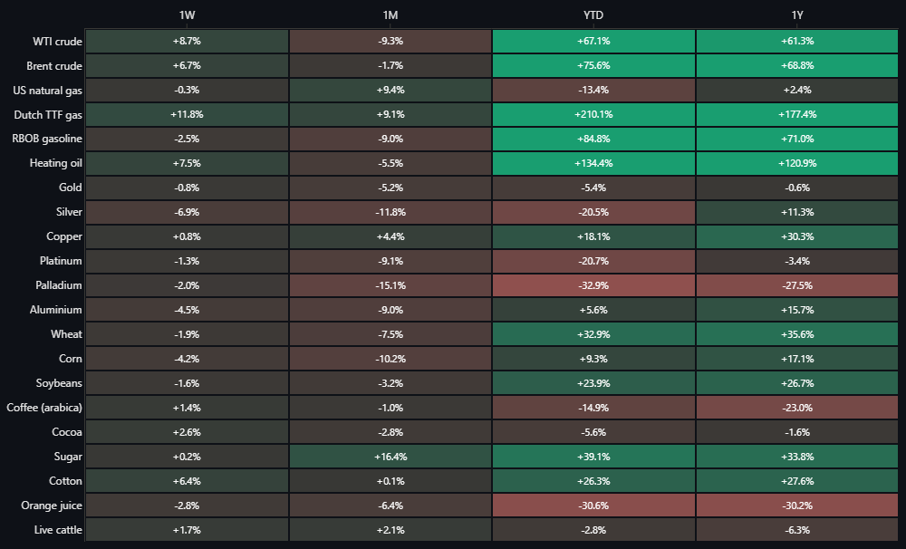
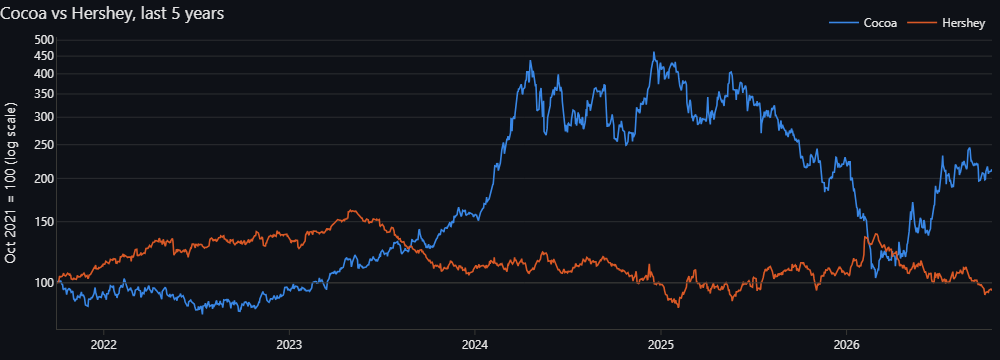
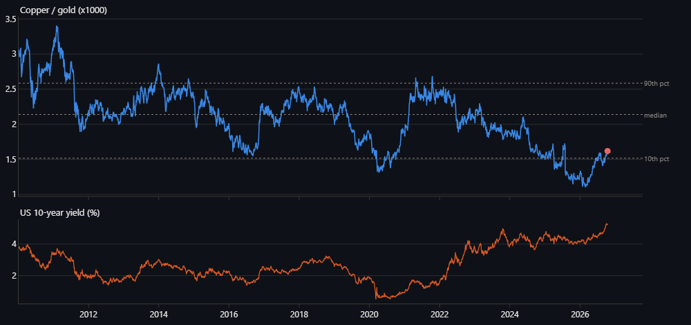
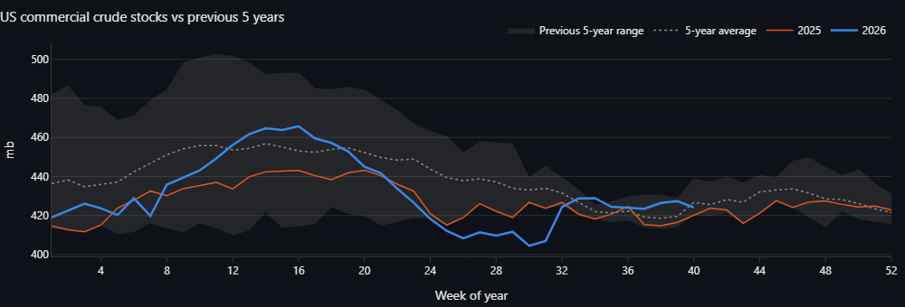

# Spot & Spread

My commodities dashboard. Power, oil, gas, metals and ags in one place, plus a few questions I wanted to dig into
properly - like whether Hershey actually trades with cocoa (it mostly doesn't, see below).

Built with Python, pandas and Streamlit. Data updates itself every morning through a GitHub Action.



## What's in it

- **Board** - every commodity I follow on one screen: price, daily move, a 3-month sparkline, returns over
  1W/1M/YTD/1Y and where each one sits in its 52-week range.
- **Ratios & spreads** - gold/silver, gold/oil, copper/gold, oil/gas, the 3-2-1 crack, Brent-WTI, soy/corn,
  TTF vs Henry Hub, platinum/gold. Each against its history since 2010, plus a build-your-own ratio.
- **Stocks vs commodities** - pairs each commodity with the listed company that depends on it most (cocoa/Hershey,
  coffee/Starbucks, copper/Freeport, gas/EQT, TTF/RWE, gold/Newmont...). Rolling correlation and beta, who moves
  first, and a "decoupling" measure for when the stock drifts away from what its commodity implies.
- **Seasonality** - month-by-month return heatmaps and the average path through the year vs this year.
- **Power** - European day-ahead prices next to load, wind and solar (ENTSO-E). Residual load vs price is basically
  the merit order drawn from data. Also spikes, forecast misses and interconnector flows.
- **Oil** - WTI/Brent, the live futures curve, weekly EIA inventories against the last five years, Cushing, and
  hedge fund positioning from the CFTC.
- **Notes** - a weekly oil note and a daily power note, written from the data with plain if/else rules.
- **Backtests** - two rule-based signals (oil and power), tested without any look-ahead.

## Some things I found

All as of October 2026.

**Cocoa went up ~350% from the start of 2023 to the end of 2024 (record ~$12,500/t in December 2024). Hershey fell
25% over the same period, but week to week the two are basically uncorrelated (about -0.1 over five years).**
The damage showed up through quarterly earnings and guidance, not in day-to-day trading.



**Gold miners are levered gold.** Over the last five years Newmont's beta to gold is about 1.6 and the GDX miners
ETF about 1.8, with correlations of 0.7-0.8. Exxon vs WTI is a much looser 0.6 correlation and a 0.4 beta.

**RWE has zero weekly correlation with TTF gas** over five years. My guess is that's hedging: utilities sell most of
their output forward years ahead, so spot gas moves don't hit them the same week.

**The copper/gold ratio used to track US 10-year yields and doesn't anymore.** The correlation of the two levels
went from +0.65 (2012-2021) to -0.67 (2022 onwards). Yields went up, and gold went up even faster.



**Nobody leads.** For nearly every stock/commodity pair the lead-lag correlation peaks at zero weeks, and where it
doesn't (cocoa/Hershey, TTF/RWE) the correlations are noise anyway. Whatever moves the commodity is in the stock
price the same week.

**Gasoline's seasonality is partly a contract thing.** On the continuous RBOB series, March was up in 9 of the
last 10 years and September down in 9 of 10. But that's also when the front month switches between winter- and
summer-grade gasoline, which trade at different prices. Natural gas is similar: August up in 9 of 10 years,
December down in 8 of 10.

**My weekly oil signal doesn't work.** It votes on four things every Thursday: inventory surprise vs the seasonal
norm, Cushing tightness, curve shape and hedge fund crowding. From 2010 to 2024 it was right 51.7% of the time -
when 52.6% of weeks went up anyway - and lost a little after costs. The inventory surprise alone was right
exactly 50% of the time: the number is public at 10:30 ET on Wednesday and priced within minutes. The curve vote
made about 10 cents a barrel a week. Not nothing, not a strategy either. I kept it in because a backtest that
says "no" is more useful than one that's been tuned until it says "yes".



## How it works

| Data | Source | How it gets here |
|---|---|---|
| Commodity, stock and macro prices | Yahoo Finance | fetched live when you open the app (cached 1h, never stored) |
| EU power prices, load, wind, solar, flows | ENTSO-E Transparency Platform | daily GitHub Action → `data/store/` |
| US crude, Cushing, products, refinery runs | EIA API (weekly report) | daily GitHub Action → `data/store/` |
| Hedge fund positioning | CFTC Commitments of Traders | daily GitHub Action → `data/store/` |

The Action (`.github/workflows/daily-update.yml`) runs `scripts/daily_update.py`. It only fetches what's new, checks
the data for nonsense before committing (`tests/test_store_integrity.py`), and Streamlit Cloud redeploys on the
commit. One API failing doesn't stop the others.

A couple of details I spent time getting right:

- **No look-ahead in the backtests.** EIA weekly data is only used from the Thursday after its Wednesday release,
  CFTC data from the Friday it's published, and power signals only use what's known before the noon day-ahead
  auction. The tests scramble every future data point and check the signals don't change. I broke this on purpose a
  few times to make sure the tests catch it.
- **Futures rolls.** Front-month series jump when one contract expires and the next takes over. For WTI I rebuild a
  roll-adjusted series from the CME expiry rule (tested against the real 2024 expiry dates). The board and ratio
  pages use Yahoo's continuous series as-is, which is fine for levels but not for backtesting.
- **Power data is messy.** 15-minute day-ahead prices since October 2025, 23 and 25-hour days at the clock changes,
  gaps in the TSO data. All of that is handled and reported, not hidden.

## Running it

```bash
python -m venv .venv
```

```bash
.venv/Scripts/pip install -r requirements.txt
```

```bash
.venv/Scripts/streamlit run app.py
```

(On Mac/Linux it's `.venv/bin/...`.)

It runs without any keys: prices come from Yahoo, and anything without real data yet falls back to synthetic sample
data, which is labelled as such. For the real stored data, copy `.env.template` to `.env` and add an
[EIA key](https://www.eia.gov/opendata/register.php) (free, instant) and/or an ENTSO-E token, then run
`python scripts/daily_update.py`.

Tests: `pytest` (about 30 seconds, fully offline).

## Layout

```
app.py                  navigation
src/markets.py          cross-commodity prices, ratios, pairs, seasonality
src/crude/              EIA/CFTC oil analytics, contract calendar, weekly signal
src/entsoe_client.py    ENTSO-E API client (XML, caching, 15-min data)
src/signal_engine.py    power signal  ·  src/backtester.py  shared backtest
src/views/              one file per page
scripts/daily_update.py the morning refresh job
data/store/             data committed by the job  ·  data/sample/  synthetic fallback data
notes/watchlist.md      my own notes, shown on the board
```

## Caveats

- Yahoo's continuous futures are delayed and unofficial, and they jump at rolls (natural gas especially).
- EIA stopped publishing NYMEX futures prices in April 2024, so the official WTI curve history ends there. The live
  curve comes from Yahoo.
- The power backtest's "entry price" is yesterday's auction price, which you can't actually trade at. Good for
  learning, not for trading.
- Not investment advice, obviously.

## Ideas for next

- [ ] Roll-adjusted continuous series for all commodities, not just WTI
- [ ] European gas storage (GIE AGSI+) next to TTF
- [ ] Weather: heating/cooling degree days vs gas and power
- [ ] Day-ahead vs intraday/imbalance prices in power - that's where forecast misses actually make money
- [ ] Coffee: Brazil frost-season risk vs the price
